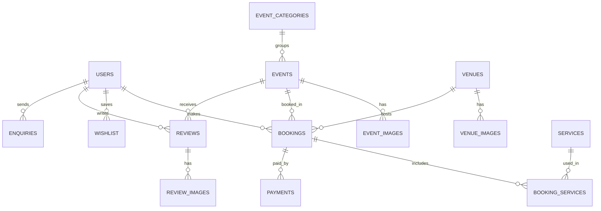

<div align="center">


# 🎉 Event Handler

### One platform to plan, book and manage every celebration

Weddings • Birthdays • Corporate Events • Engagements • Anniversaries • Parties

<br />


[Features](#-features) • [Tech Stack](#-tech-stack) • [Database](#-database-design) • [Installation](#-installation--setup) • [API](#-api-endpoints) • [Roadmap](#-roadmap)

</div>

---

## 📖 About The Project

**Event Handler** is a full-stack event management and booking platform. Users can explore event packages, filter them by category, price, guests and duration, pick a venue, add extra services, save favourites to a wishlist, book the event and pay online. Vendors and admins can manage events, venues, services and bookings from one place.

> 💡 **Motto:** *"Apni occasion chuno, baaki hum sambhal lenge."*

---

## ✨ Features

### 👤 For Users
| Feature | Description |
|---|---|
| 🔍 **Explore Events** | Browse all event packages with images, price, guests and duration |
| 🗂️ **Event Categories** | Wedding, Birthday, Engagement, Office Party, Anniversary and more |
| 🎛️ **Smart Filters** | Search, sort, category, price range, guest count, duration, featured only |
| 📦 **Packages** | Ready-made event packages with base price + per-guest price |
| 🏛️ **Venues** | View venues with photo galleries, capacity and pricing |
| 🛎️ **Add-on Services** | Decor, catering, DJ, photography and more |
| ❤️ **Wishlist** | Save favourite events and venues |
| 🎟️ **Bookings** | Book an event with date, guests, venue and services |
| 💳 **Payments** | Track payment status for every booking |
| 💬 **Reviews & Feedback** | Rate events and upload review photos |
| 📩 **Enquiries** | Ask questions before booking |
| 👤 **My Profile** | Manage personal details and booking history |

### 🏢 For Vendors / Admin
- Add, edit and delete events, venues and services
- Upload and manage event and venue images
- View and manage incoming bookings and enquiries
- Track payments and reviews
- Mark events as **Featured**

### 🎨 UI / UX
- Fully responsive (mobile, tablet, desktop)
- Animated sidebar with focus trap and keyboard support (`Esc`, `Tab`)
- Clean Tailwind CSS design with a sky-blue and indigo theme
- Graceful loading, empty and error states
- Broken image fallback so the layout never breaks

---

## 🛠️ Tech Stack

| Layer | Technology |
|---|---|
| **Frontend** | React, Vite, React Router DOM, Axios |
| **Styling** | Tailwind CSS |
| **Backend** | Node.js, Express.js |
| **Database** | PostgreSQL (managed with pgAdmin) |
| **Tools** | VS Code, Git, GitHub, Postman |

---

## 🗄️ Database Design

The `EventsDB` PostgreSQL database contains **14 tables**:

| # | Table | Purpose |
|---|---|---|
| 1 | `users` | Registered users, vendors and admins |
| 2 | `event_categories` | Wedding, Birthday, Engagement, etc. |
| 3 | `events` | Event packages and pricing |
| 4 | `event_images` | Image gallery for each event |
| 5 | `venues` | Venue details and capacity |
| 6 | `venue_images` | Image gallery for each venue |
| 7 | `services` | Add-on services (decor, catering, DJ...) |
| 8 | `bookings` | Event bookings made by users |
| 9 | `booking_services` | Services selected within a booking |
| 10 | `payments` | Payment records of bookings |
| 11 | `reviews` | Ratings and feedback |
| 12 | `review_images` | Photos attached to reviews |
| 13 | `wishlist` | Saved events and venues |
| 14 | `enquiries` | User questions and enquiries |

### 🔗 Entity Relationship (overview)



> ⚠️ Adjust the relationships above if your column names differ.

---

## 📂 Project Structure

```
Event_Handler/
├── client/                      # React frontend (Vite)
│   ├── public/                  # Logo and static images
│   └── src/
│       ├── components/
│       │   └── Navbar.jsx       # Navbar + animated sidebar
│       ├── pages/
│       │   ├── Home.jsx
│       │   ├── Events.jsx       # Categories + filters + events grid
│       │   └── EventDetails.jsx
│       ├── api.js               # Axios instance
│       ├── data.js              # Sidebar links
│       ├── App.jsx              # Routes
│       └── main.jsx
│
├── server/                      # Node.js + Express backend
│   ├── routes/
│   ├── controllers/
│   ├── db.js                    # PostgreSQL connection
│   ├── server.js
│   └── .env
│
├── .gitignore
└── README.md
```

> 📝 Update folder names to match your actual project.

---

## 🚀 Installation & Setup

### ✅ Prerequisites
- [Node.js](https://nodejs.org) (v18 or above)
- [PostgreSQL](https://www.postgresql.org/download/) and pgAdmin
- [Git](https://git-scm.com)

### 1️⃣ Clone the repository

```bash
git clone https://github.com/piyush-2416/Events_Handler.git
cd Events_Handler
```

### 2️⃣ Setup the database

1. Open **pgAdmin** and create a database named `EventsDB`
2. Open the **Query Tool** and run your SQL script to create the tables
3. Insert some sample data (categories, events, venues, services)

### 3️⃣ Setup the backend

```bash
cd server
npm install
```

Create a `.env` file inside `server/`:

```env
PORT=5000
DB_HOST=localhost
DB_PORT=5432
DB_USER=postgres
DB_PASSWORD=your_password
DB_NAME=EventsDB
```

Start the server:

```bash
npm run dev
```

### 4️⃣ Setup the frontend

```bash
cd client
npm install
npm run dev
```

Open **http://localhost:5173** in your browser. 🎉

---

## 🔌 API Endpoints

| Method | Endpoint | Description |
|---|---|---|
| `GET` | `/categories` | Get all event categories |
| `GET` | `/events` | Get all events |
| `GET` | `/events?category=wedding` | Get events by category |
| `GET` | `/events/:id` | Get a single event with images |
| `GET` | `/venues` | Get all venues |
| `GET` | `/services` | Get all add-on services |
| `POST` | `/bookings` | Create a booking |
| `GET` | `/bookings/user/:id` | Get bookings of a user |
| `POST` | `/payments` | Record a payment |
| `GET` | `/wishlist/:userId` | Get a user's wishlist |
| `POST` | `/wishlist` | Add to wishlist |
| `DELETE` | `/wishlist/:id` | Remove from wishlist |
| `POST` | `/reviews` | Add a review |
| `POST` | `/enquiries` | Send an enquiry |
| `POST` | `/auth/register` | Register a user |
| `POST` | `/auth/login` | Login |

> Endpoints marked beyond `/categories` and `/events` are planned or in progress. Update this table as you build them.

---

## 🧭 App Routes (Frontend)

| Route | Page |
|---|---|
| `/` | Dashboard / Home |
| `/events` | Explore Events |
| `/events/:id` | Event Details |
| `/my-events` | My Events |
| `/bookings` | Bookings |
| `/vendors` | Vendors |
| `/wishlist` | Wishlist |
| `/packages` | Packages |
| `/reviews` | Reviews & Feedback |
| `/profile` | My Profile |

---

## 📸 Screenshots

> Add your screenshots in a `screenshots/` folder and link them here.

| Home | Explore Events |
|---|---|
|  |  |

| Filters | Event Details |
|---|---|
|  |  |

---

## 🗺️ Roadmap

### ✅ Completed
- [x] Navbar with animated sidebar
- [x] Event categories section
- [x] Events listing from PostgreSQL
- [x] Filters (search, sort, category, price, guests, duration, featured)

### 🚧 In Progress
- [ ] Event Details page
- [ ] Wishlist
- [ ] Booking flow

### 🔮 Planned Features
- [ ] User authentication (JWT login and signup)
- [ ] Role-based access (User, Vendor, Admin)
- [ ] Vendor dashboard with analytics
- [ ] Venue availability calendar
- [ ] Online payments (Razorpay / Stripe)
- [ ] Email and SMS booking confirmations
- [ ] Notifications (the bell icon in the navbar)
- [ ] Reviews with photo upload
- [ ] Custom package builder
- [ ] Budget calculator based on guests and services
- [ ] Guest list and invitation manager
- [ ] Event checklist and timeline planner
- [ ] Map view and location search for venues
- [ ] Coupons, discounts and seasonal offers
- [ ] Compare events side by side
- [ ] Live chat with vendors
- [ ] Download booking invoice as PDF
- [ ] Admin panel
- [ ] Dark mode
- [ ] Multi-language support (Hindi / English)
- [ ] PWA support

---

## 🤝 Contributing

Contributions are welcome!

1. Fork the repository
2. Create a branch: `git checkout -b feature/amazing-feature`
3. Commit your changes: `git commit -m "Add amazing feature"`
4. Push to the branch: `git push origin feature/amazing-feature`
5. Open a Pull Request

---

## 📄 License

This project is licensed under the **MIT License**.

---

## 👨‍💻 Author

**Piyush**

[](https://github.com/piyush-2416)

---

<div align="center">

⭐ If you like this project, give it a star on GitHub! ⭐

Made with ❤️ using React, Tailwind CSS, Node.js and PostgreSQL

</div>
